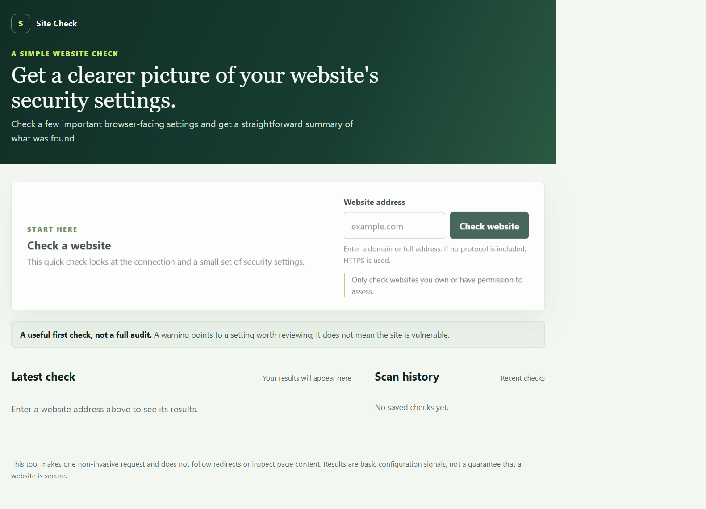
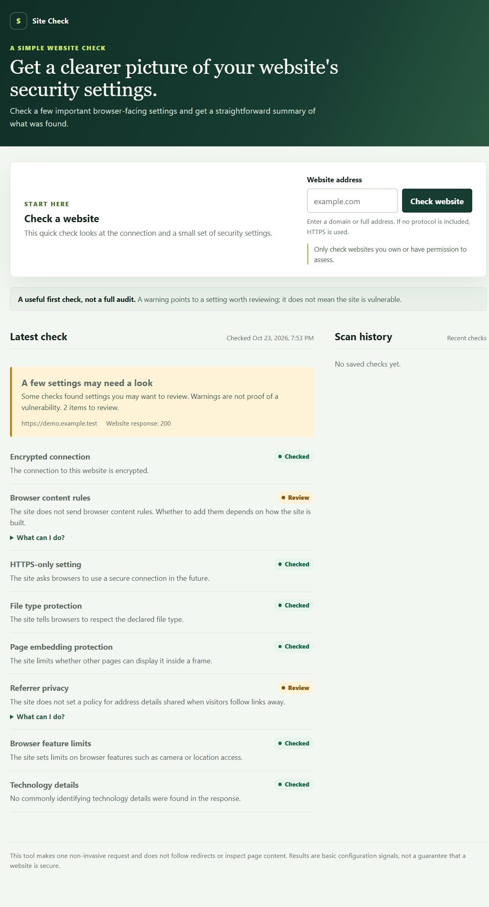

# Mini Web Security Scanner

A simple web app for checking HTTPS and common website security settings. It gives plain-language results and scan history, backed by a non-invasive scanner that makes one HTTP GET request to an authorized target. It does not exploit the target, follow redirects, or execute response content. A missing header is a signal to review, not proof that a site is vulnerable.

> **Repository description:** A lightweight website security checker with plain-language results, scan history, SSRF safeguards, SQLite storage, and offline tests.

## Screenshots

These screenshots show the browser-based scanner. The example results use synthetic data and a reserved demo hostname; no live website was scanned.





## Sample result

Using a mocked HTTP 200 response that includes HSTS, `X-Content-Type-Options`, `X-Frame-Options`, and `Permissions-Policy`, the scanner returns `completed_with_warnings`:

| Check | Result | Explanation |
| --- | --- | --- |
| HTTPS | Pass | The target URL uses HTTPS. |
| Content-Security-Policy | Warning | Header is missing; relevance depends on the application. |
| Strict-Transport-Security | Pass | Header is present. |
| X-Content-Type-Options | Pass | Header is present. |
| Frame restriction | Pass | `X-Frame-Options` is present. |
| Referrer-Policy | Warning | Header is missing; relevance depends on privacy requirements. |
| Permissions-Policy | Pass | Header is present. |
| Technology disclosure | Warning | A `Server` header is present; this alone does not establish a vulnerability. |

This sample was generated with `httpx.MockTransport`; no external host was contacted. Findings are basic configuration signals, not a vulnerability verdict.

## Requirements

- Python 3.12 or newer
- Windows PowerShell

## Setup and run

From the project directory in PowerShell:

```powershell
py -3.12 -m venv .venv
.\.venv\Scripts\Activate.ps1
python -m pip install -r requirements.txt
python -m uvicorn app.main:app --reload
```

If PowerShell prevents virtual-environment activation, run `Set-ExecutionPolicy -Scope Process -ExecutionPolicy Bypass` in that PowerShell window, then activate again.

Open the scanner at [http://127.0.0.1:8000](http://127.0.0.1:8000). The API creates `scanner.db` in the project directory on startup. API documentation remains available at [http://127.0.0.1:8000/docs](http://127.0.0.1:8000/docs).

## API

### `GET /health`

Returns `{"status":"ok"}` when the API is running.

### `POST /scans`

Request:

```json
{
  "url": "https://example.com"
}
```

Example response (abbreviated; actual scans return all check findings):

```json
{
  "id": "c1630e7a-fc2f-45f0-9c85-66b0a21674e0",
  "url": "https://example.com",
  "scanned_at": "2026-10-22T19:00:00+00:00",
  "http_status": 200,
  "status": "completed_with_warnings",
  "findings": [
    {
      "check_name": "https",
      "status": "pass",
      "severity": "informational",
      "explanation": "The target uses HTTPS.",
      "remediation": "No action needed."
    }
  ]
}
```

The response includes findings for HTTPS, Content-Security-Policy, Strict-Transport-Security, X-Content-Type-Options, frame restrictions, Referrer-Policy, Permissions-Policy, and technology-identifying response headers. Operational errors such as timeouts are also recorded as findings. URL validation failures return HTTP 422; a scan is saved even when the network request fails.

Only scan a host you own or have explicit permission to assess. The sample hostname above is illustrative and is not intended as a live scan target.

Example PowerShell request:

```powershell
Invoke-RestMethod -Method Post `
  -Uri http://127.0.0.1:8000/scans `
  -ContentType "application/json" `
  -Body '{"url":"https://example.com"}'
```

### `GET /scans?limit=20`

Returns recent scan summaries. `limit` must be from 1 to 100.

### `GET /scans/{scan_id}`

Returns the saved scan and its findings. Unknown IDs return HTTP 404.

## Design and safety

- URL validation permits only absolute HTTP or HTTPS URLs and rejects embedded credentials, local hostnames, and non-global IP addresses.
- Hostnames are resolved before the HTTP request. Every resolved address must be globally routable; DNS failures and mixed public/private answers are rejected.
- Redirects are disabled, so a redirect destination is never contacted automatically.
- The request uses connection/read timeouts, does not trust proxy environment variables, and stops reading after 1 MB.
- SQLite uses parameterized queries and stores findings as JSON. The database is created automatically on application startup and is ignored by Git.
- Logs contain failure categories, not full URLs, response bodies, or credentials. Response content is not executed.
- The service makes one GET per scan; it does not crawl, brute-force paths, scan ports, test credentials, or make destructive requests.

This is an interview/demo project, not a production-ready scanner. DNS is resolved for validation and then resolved again by the HTTP client's networking stack when connecting; this creates a DNS-rebinding time-of-check/time-of-use limitation. Run only in a trusted environment and scan targets you are authorized to assess. Header presence is a basic signal and does not prove that a policy is correct or that an application is secure.

## Tests

Tests use mocked HTTP transports and patched DNS resolution; they do not make requests to real websites or require internet access.

```powershell
python -m pytest -q
```
i will add this line just to test the commit option 